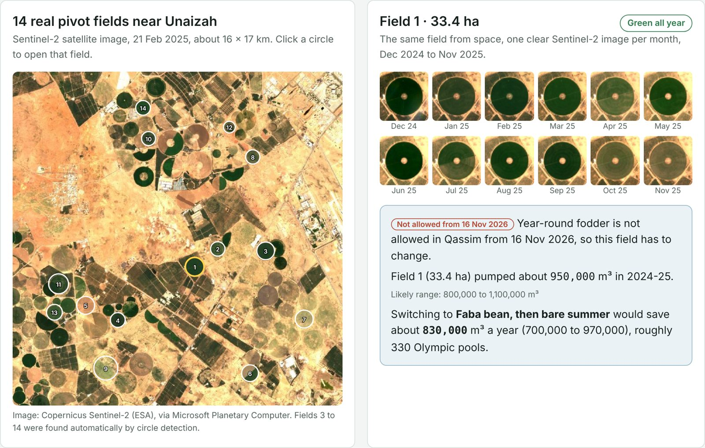
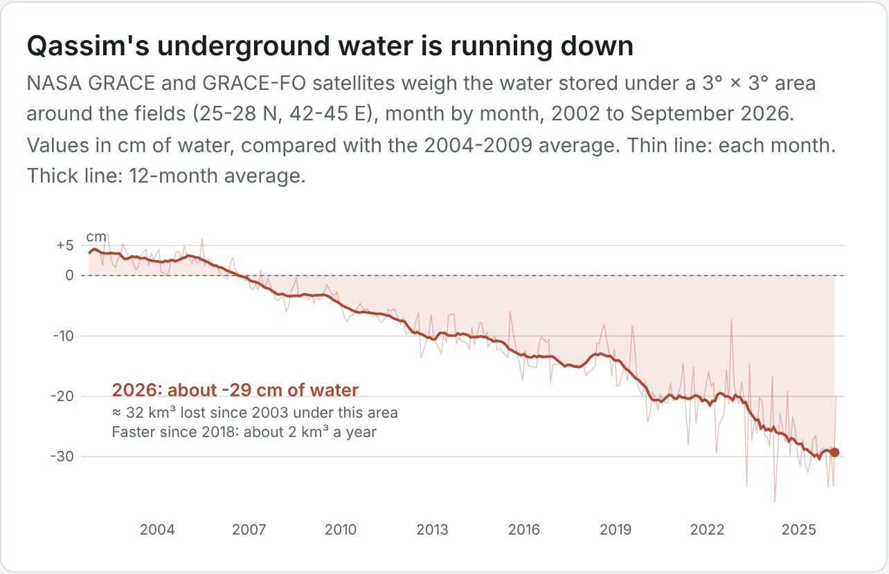
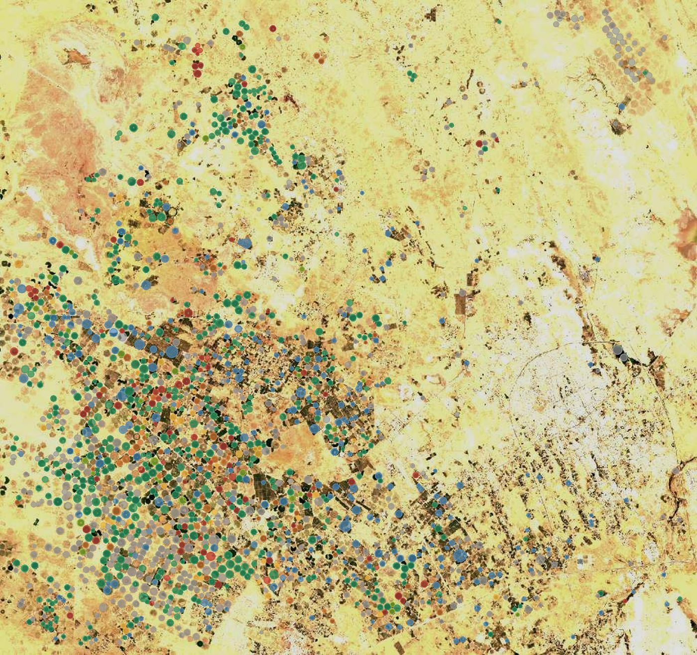

# Qatra (قطرة): a water bill for every crop option

NASA Space Apps Challenge 2026 · Challenge: **Field Shift: Adapting Farms with NASA Data** · Local event: Jazan, Saudi Arabia

Qatra shows a farmer in Qassim, Saudi Arabia, how much groundwater each crop rotation would pump on their own center-pivot field. It covers 14 real pivots near Unaizah (2 picked by hand, 12 found automatically in a Sentinel-2 image), shows each one from space every month, and opens with NASA GRACE data on how fast the region's underground water is falling. It reads the field's real crop history from Landsat, runs 11 years of NASA POWER weather through the FAO-56 crop water method, and ranks five options by the farmer's own priorities (save water, build soil, avoid heat stress, earn more, sure buyer). Every option shows its evidence and what a local expert should check.

**Live demo:** https://mbassam2009.github.io/qatra/ (or open `index.html` in any browser, no install needed). Click a field on the map.

**Why now:** From 16 November 2026, MEWA stops year-round (perennial) fodder in Qassim and the other sedimentary-shelf regions; licensed seasonal fodder (Egyptian clover, ryegrass) stays allowed. On our map, 93 pivots stay green all year and pump about 65 million m³ a year. Qatra shows each one what to switch to, the water it saves and the crop value.

## Results for two real pivots in Qassim (about 36 km NW of Unaizah)

| Rotation | Pumped water (m³/ha/yr, 10-season average) | Heat-stress days/yr | Soil score (0-4) | Crop value (SAR/ha) | SAR per m³ |
|---|---|---|---|---|---|
| A. Year-round fodder (Field 1 since 2020; not allowed from 16 Nov 2026) | 30,078 (28,492 to 30,998) | 126 | 3 | 43,940 | 1.46 |
| B. Berseem clover (winter fodder), then summer fallow | 8,482 | 30 | 2 | 24,530 | 2.89 |
| C. Wheat, then summer fallow (what Field 2 did in 2025) | 8,378 | 35 | 1 | 10,500 | 1.25 |
| D. Faba bean, then summer fallow | 3,605 | 8 | 2 | 10,800 | 3.00 |
| E. Wheat and faba bean in turns (one each year) | 5,991 | 21 | 3 | 10,650 | 1.78 |

The demo ranks the allowed options with six sliders: save water, build soil, avoid heat stress, earn more per hectare, sure buyer and least change (how close an option is to what the field grows now, from its satellite record: fodder fields are closest to berseem, wheat fields to wheat and the wheat/faba rotation). With the default settings, fodder fields get berseem and other fields get wheat and faba bean in turns. Sure buyer scores: wheat 3: government set price; fodder 2: local livestock demand; faba bean 1: no set price, competes with imports. Each option can win: faba bean on water and heat, berseem on income, wheat on a sure buyer.

Crop value = typical yield × price, before costs: wheat 6 t/ha × 1,750 SAR/t (MEWA purchase price, USDA FAS Dec 2025); alfalfa 20.6 t/ha (Saudi average) × 2,133 SAR/t (32 SAR per 15 kg bale retail, USDA FAS; farm-gate is lower); berseem 11.5 t/ha (middle of Estidamah's 8-15 t/ha) at the alfalfa price; faba bean 4 t/ha (KSU trials: 4.9-5.2) × 2,700 SAR/t (2023 import price). Berseem stage lengths are our assumption (Nov to Apr); its Kc is FAO-56 Table 12.

Field 1 is 33.4 ha and grows fodder all year, which is not allowed from 16 Nov 2026. Switching to berseem (B), the closest legal option, would pump about **670,000 m³ less per year** (likely 560,000 to 780,000; see the ground check below); faba bean (D) about 830,000 m³ less.
Reference ET at the fields averages 2,547 mm/yr against 80 mm/yr of rain (NASA POWER, 2015-2025).

## Regional context (GRACE)

NASA GRACE/GRACE-FO (JPL mascon CRI, via NASA GIBS) over 25-28 N, 42-45 E: water storage fell from about +4 cm (2003) to -17.7 cm (mid-2022) against the 2004-2009 average, a trend of -1.2 cm a year, about 22 km³ lost under this 3° × 3° area (`fetch_grace_gibs.py`, `data/grace_qassim.csv`).

## All 14 fields (`fields.py`, `data/fields.json`)

Each field's 2024-25 water use is estimated from its own monthly Landsat greenness (cover × ET0, minus effective rain, ÷ 0.8). The 14 fields pumped about 5.5 million m³ in 2024-25 by this FAO-56-style estimate, likely 4.6 to 6.4 million m³. Field 1 (33.4 ha, green all year) pumped about 949,000 m³; Field 2 (19.6 ha, winter crop only) about 142,000 m³.

## Scaling up: 1,553 pivots in central Qassim (`wide_pivots.py`, `fetch_wide_s2.js`, `data/wide_pivots.csv`)

The same water method on a 73 × 69 km area west of Buraydah (43.35-44.08 E, 26.13-26.75 N, one Sentinel-2 tile). Pivots are found automatically in the highest NDVI of 12 monthly Sentinel-2 images (Dec 2024 to Nov 2025), and each one's water comes from its own monthly Sentinel-2 greenness.

- 1,553 pivots, about 41,600 ha, pumping about 350 to 490 million m³ in a year (central 417 million).
- The 215 pivots that stay green through summer (14%) pump 30% of the water. Winter-only pivots are the biggest group (535) and use far less per hectare.

Click any pivot in the demo to see its water use and what each allowed option (berseem, wheat, faba bean) would use, save and earn on that field.

Detection check: in a random sample of 80 detected circles, 68 are clearly pivots, 8 are unclear and 4 are not pivots (about 85 to 95% correct). Faint or partly farmed pivots are often missed, so the count is a minimum.

Colours: red green all year, orange two crops, yellow summer only, light green autumn to early summer, green winter only, blue part of the circle, grey mostly bare.

- Check: on 10 of the 14 fields above, the Sentinel-2 method gives the same pattern as Landsat for 8, and about 15% less water in total, so the area total leans low. Some pivots are missed, and a few circles may not be pivots.

## How it works

1. **Data in:** NASA POWER daily weather (Tmax, Tmin, RH, wind at 2 m, solar radiation, rain), 2015-2025, at 26.296 N, 43.723 E. Landsat 8/9 Collection 2 Level-2 surface reflectance, 299 scenes, via Microsoft Planetary Computer.
2. **Prepare:** FAO-56 Penman-Monteith reference ET (`et0.py`, checked against FAO-56 Example 18: 3.88 vs 3.9 mm/day). Field greenness (NDVI) averaged over a ring inside each pivot (skipping the bare pivot point and the edge); cloudy passes removed by blue reflectance.
3. **Build:** for each day of each crop year, crop ET = Kc × ET0 (FAO-56 Tables 11-12), minus effective rain, divided by 80% pivot efficiency. Heat-stress days = days above each crop's rough heat limit. Simple soil score: legume (+2), soil covered 8+ months (+1), cereal stubble (+1).
4. **Result:** five options ranked by the farmer's sliders, starting from what the field grows now, with whole-field totals and the change vs today.

## Run it

    pip install -r requirements.txt
    python fetch_power.py          # NASA POWER weather -> data/power.csv (already included)
    python fetch_landsat_ndvi.py   # Landsat NDVI for both fields -> data/ndvi_clean.csv (already included)
    python model.py                # prints the results table
    streamlit run app.py           # optional Python version of the app

## Files

- `config.py`: the two fields (centre, radius), years, pivot efficiency
- `et0.py`: FAO-56 Penman-Monteith reference ET
- `crops.py`: crop coefficients, stage lengths, heat limits, the five options, prices and the 'least change' scores, with sources
- `model.py`: water, heat and soil results per rotation
- `fetch_power.py`, `fetch_landsat_ndvi.py`, `gee_ndvi.js`: data download scripts
- `check_ecostress.py`: compares ECOSTRESS daily ET with reference ET and Landsat crop state
- `fields.py`: classifies all 14 fields from Landsat and estimates their 2024-25 water use
- `fetch_grace_gibs.py`: GRACE/GRACE-FO water storage for the Qassim area from NASA GIBS
- `wide_pivots.py`, `fetch_wide_s2.js`: find all pivots in central Qassim and estimate their water
- `app.py`: Streamlit app; `index.html`: the standalone web demo
- `data/`: power.csv, ndvi_raw.csv, ndvi_clean.csv (14 fields), elev.txt, ecostress_jet_raw.csv, ecostress_check.csv, grace_qassim.csv, fields.json, wide_pivots.csv (1,553 pivots), s2_ndvi_max_2025.jpg

## Next steps

1. Ask MEWA for meter readings from a few farm wells (Hafiz platform) to turn our ±15% range into measured numbers.
2. Compare our numbers with the KAUST satellite study of 35,000 Saudi pivots.
3. An Arabic version that works on a phone, tested with 3 to 5 farmers near Unaizah.
4. Scale to all of Saudi Arabia: the pivot finder runs tile by tile, starting with the six regions under the fodder rule (Qassim, Riyadh, Hail, Al-Jawf, Tabuk, Eastern Province). Then other farm types: square fields, date palm orchards and greenhouses.
5. Add pumping cost, farm-gate prices and GRACE-FO data up to 2026.

## Limits

- Crop water follows FAO-56 coefficients for the closest arid regions, not field measurements in Qassim.
- Pivot efficiency is assumed at 80%. Heat limits are rough thresholds. Crop value is yield × price before costs; pumping cost is not included.
- The crop on Field 1 (alfalfa or Rhodes grass) is inferred from Landsat, not confirmed on the ground.
- Ground check: An eddy-covariance tower on a 50 ha alfalfa pivot in eastern Saudi Arabia measured about 2,430 mm of water use from June 2013 to May 2014 (Al-Gaadi et al. 2017), and FAO-56 gives about 2,400 mm for year-round fodder at our fields (within about 1%). So FAO-56 is our central estimate. The likely range, about -15% to +17%, covers crop water ±10% and pivot efficiency 75 to 85% (`config.py`). ECOSTRESS reads about a third of this on green pivots; our best explanation is that hot, dry desert air pulls extra water from small irrigated fields and the models behind ECOSTRESS miss it.
- ECOSTRESS check (`check_ecostress.py`, 438 readings of ECO_L3T_JET.002 daily ET at 8 points, 2019-2025, via AppEEARS): ECOSTRESS follows crop state (median ET/ET0 0.10 on bare, 0.22 partly green, 0.35 green; correlation 0.64 with Landsat NDVI), but on green fields it measures about a third of what FAO-56 assumes (Kc 0.95-1.15). We do not use ECOSTRESS for the amount: see the ground check below. AppEEARS labels ETdaily as W/m², but the values (0-8.5) only make sense as mm/day, so we read them as mm/day. Morning overpasses read lower than afternoon ones, a sign the daily upscaling adds uncertainty.

## NASA data and references

- MEWA, halt of perennial fodder cultivation from 16 Nov 2026: https://www.mewa.gov.sa/ar/MediaCenter/News/Pages/saudi-stopping-perennial-fodder-cultivation.aspx
- USDA FAS GAIN, Saudi Arabia Grain and Feed (Dec 2025), wheat yield and price, alfalfa bale price: https://agriexchange.apeda.gov.in/MarketReport/11351060520251227154317183.pdf
- Estidamah seasonal forage research (Arab News, Jan 2026): https://www.arabnews.pk/node/2630925/saudi-arabia
- Migdadi et al. 2016, faba bean yields at Dirab, KSU: https://thejaps.org.pk/manuscript/2016-japs-232.pdf
- UN Comtrade via WITS, Saudi faba bean imports 2023: https://wits.worldbank.org/trade/comtrade/en/country/ALL/year/2023/tradeflow/Imports/partner/WLD/product/071350

- Al-Gaadi, Madugundu & Tola (2017), alfalfa water use measured by eddy covariance on a center pivot in eastern Saudi Arabia: https://parc.ksu.edu.sa/sites/parc.ksu.edu.sa/files/imce_images/temporal_dynamics_of_alfalfa_water_use_efficiency_under_hyper_arid_conditions_of_saudi_arabia_1.pdf

- NASA POWER daily data: https://power.larc.nasa.gov/
- Landsat 8/9 Collection 2 Level-2 (NASA/USGS), via Microsoft Planetary Computer: https://planetarycomputer.microsoft.com/api/stac/v1/collections/landsat-c2-l2
- GRACE result for the Saq aquifer (about -2 km³/yr, 2002-2016; ~88% of use is irrigation): Arabian Journal for Science and Engineering, 2019, https://link.springer.com/article/10.1007/s13369-019-04069-1
- Allen et al. 1998, FAO Irrigation and Drainage Paper 56 (Crop evapotranspiration): https://www.fao.org/4/x0490e/x0490e0b.htm (Chapter 6, Tables 11-12)
- KAUST, satellite monitoring of groundwater use by center pivots (prior work): https://discovery.kaust.edu.sa/en/article/6446/monitoring-precious-groundwater-resources-for-arid-agricultural-regions/
- ECOSTRESS ECO_L3T_JET.002 (Hook & Halverson 2024): https://doi.org/10.5067/ECOSTRESS/ECO_L3T_JET.002, accessed through NASA AppEEARS v3.137
- GRACE/GRACE-FO JPL mascon CRI RL06.3 (PO.DAAC), served by NASA GIBS layer GRACE_Tellus_Liquid_Water_Equivalent_Thickness_Mascon_CRI: https://podaac.jpl.nasa.gov/dataset/TELLUS_GRAC-GRFO_MASCON_CRI_GRID_RL06.3_V4
- Copernicus Sentinel-2 L2A (ESA), via Microsoft Planetary Computer, for the map, monthly images and pivot detection
- Saudi green fodder cultivation ban, Nov 2018: https://www.argaam.com/en/article/articledetail/id/568056
- AI: Claude (Anthropic) was used for research, coding and design help (see the project page).
